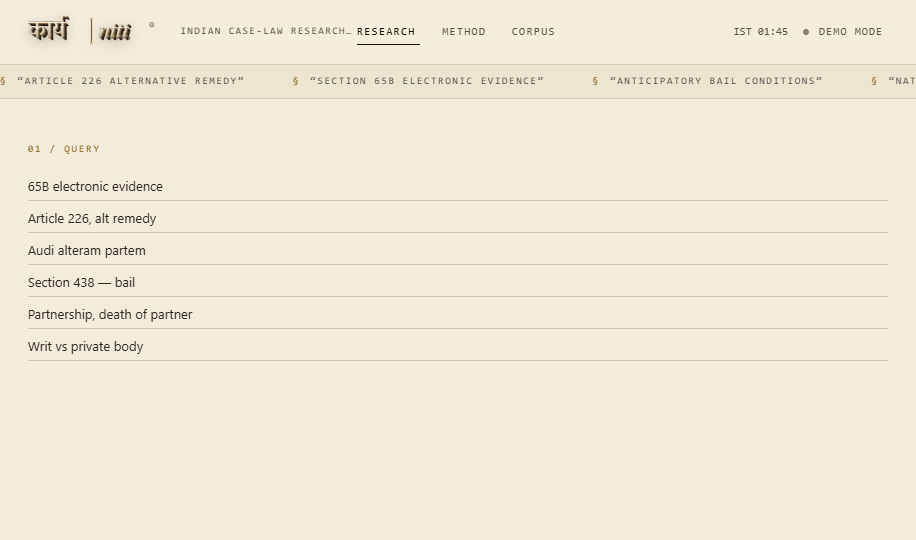

# Karyaniti

A case-law research tool for Indian lawyers that checks its own citations. You type a legal question; it finds Supreme Court and High Court judgments on [Indian Kanoon](https://indiankanoon.org), pulls the actual text, and only shows a holding if it can point to the paragraph that supports it.



**Status: archived.** I built this between May and July 2026 and have stopped working on it. The code is here as a record of what I built and what I learned. See [Why I stopped](#why-i-stopped).

## The problem

Lawyers who try LLMs for research hit the same wall: the model cites cases that do not exist, or real cases that do not say what the model claims. A wrong citation in a filing is a serious professional problem, so one bad answer is enough for a lawyer to stop using the tool.

## How it works

The model is never trusted to remember the law. It only suggests where to look, and every claim is checked against the fetched judgment.

1. **Query expansion.** The question is rewritten into several search queries in the vocabulary judgments use. Statute queries (for example "Section 438 CrPC") also pull the cases that cite that section.
2. **Search and rerank.** Queries run against the Indian Kanoon API. Candidates are reranked for legal relevance.
3. **Case-name resolution.** `authority_index.py` maps about 13,000 citation strings (for example `(1994) 2 SCC 14`) to Indian Kanoon document ids, so a named case or citation resolves to the right document instead of relying on keyword search.
4. **Fetch and parse.** The full judgment is fetched and split into paragraphs. Each paragraph is tagged, so that counsel's submissions and quoted passages are not mistaken for what the court held.
5. **Extract.** A model proposes holdings, each with a verbatim anchor quote and a paragraph number.
6. **Verify.** Each proposed holding goes through:
   - a string check that the anchor quote really appears in that paragraph
   - an attribution check that the paragraph is the court speaking, not a party's argument or an earlier case being quoted
   - a faithfulness check that the stated proposition follows from the quote
   - an adversary model that argues against it, and a judge model that gives the final verdict
7. **Good-law check.** `treatment_status.py` flags or drops cases known to be overruled, partly overruled or superseded by statute. This is a small hand-curated list, not a full citator.
8. **Synthesis.** A research note is written from the verified holdings only, with a link to the source paragraph for each one.

Parsed judgments are cached in a local SQLite file so repeat queries do not pay for the same document twice.

## Repository layout

| Path | What it is |
| --- | --- |
| `main.py` | FastAPI server and the whole research pipeline |
| `authority_index.py` | Generated map from citation strings to Indian Kanoon document ids |
| `treatment_status.py`, `data/treatment_status.json` | Overruled / modified case list |
| `authority_build/` | Scripts that built the authority index (doctrine seed list, resolver, scraper phases) |
| `Karyaniti.html`, `app.js`, `styles.css` | Lawyer-facing UI |
| `index-dev.html` | Developer UI with a model picker for each pipeline role |
| `karyaniti_test_set.py`, `run_breaking_tests.py` | Adversarial query set with must-find and must-reject lists fixed before running |
| `run_test_set.py`, `overnight_runner.py`, `test_generator_ab.py`, `test_intern_queries.py` | Other evaluation runners |
| `scrape_ik.py`, `supplement_phase1.py`, `merge_supplement.py`, `audit_supplements*.py` and similar | One-off scripts used to extend and audit the authority index |
| `DEPLOY.md` | Notes on sharing a running copy with testers |

## Running it

You need Python 3.10+, an [Indian Kanoon API](https://api.indiankanoon.org) token and an [OpenRouter](https://openrouter.ai) key. Indian Kanoon charges per search and per document.

```bash
pip install -r requirements.txt
cp .env.example .env      # then add your keys and pick models
python main.py
```

Open http://localhost:8765 for the main UI, or http://localhost:8765/dev for the developer UI.

## Evaluation

`karyaniti_test_set.py` holds ten hard queries. Each has a list of authorities the tool must find and a list of things it must not show, such as a counsel's argument presented as the court's holding. The lists were written before running the tool. Any must-reject item in the output counts as a failure for that query, because one wrong attribution is what loses a lawyer's trust.

## What I learned

- **Users want recall, with confidence marked.** My first versions hid anything that failed a check. The three or four law students I showed it to, all of whom had done legal internships, wanted the opposite: show every relevant authority and mark how sure the tool is. A verified but thin answer loses to an unverified but complete one, because they will read the cases themselves anyway.
- **Attribution is the hard verification problem.** Checking that a quote exists is easy. The damaging errors were quotes that were real but came from counsel's submissions or from an earlier judgment being discussed.
- **Retrieval was the bottleneck.** Keyword search on Indian Kanoon is weak for case-name and doctrine queries. Most of the later work, including the authority index, was about getting the right judgment into the candidate set at all. No amount of verification helps if the leading case was never retrieved.

## Why I stopped

The blocker was the data source. A tool like this is only as trustworthy as the text it checks against, and a verified source of Indian case law was hard to get. The databases lawyers actually trust, such as SCC Online and Manupatra, are run by large companies and sit behind paywalls. Without access to one of them, I could verify against Indian Kanoon but could not give lawyers the reporter-grade text and treatment status they rely on, so I stopped here.

## Limitations

This is a prototype and not legal advice. The treatment-status list is incomplete, the authority index covers only cases it was seeded with, and results depend on which models you configure. Check every citation against an official reporter before relying on it.

## Credits

Judgment text comes from the Indian Kanoon API and is not stored in this repository. Built by Sibayan Mitra.
